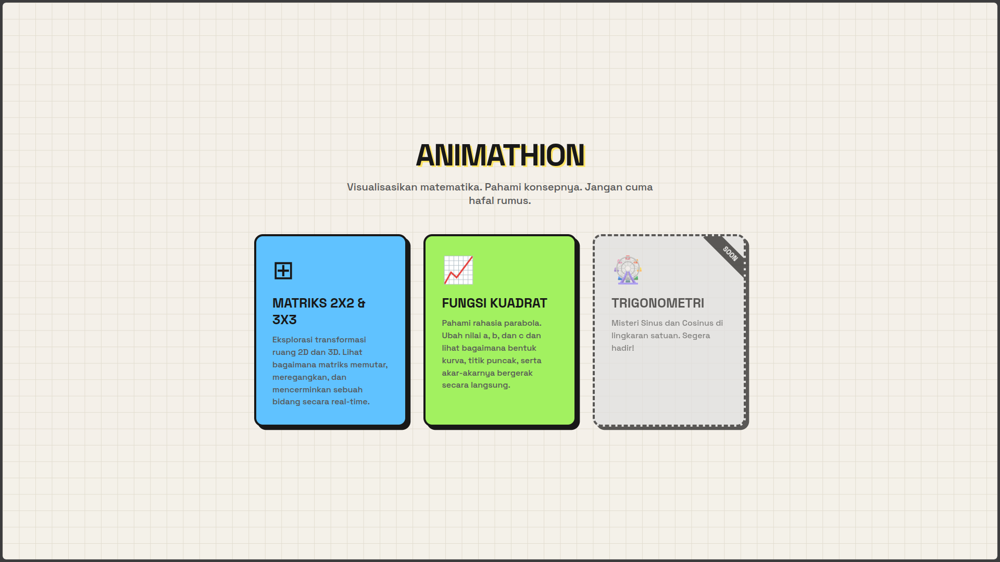

<div align="center">

<h1>ANIMATHION</h1>

<p>
  <strong>Visualisasikan Matematika. Pahami Konsepnya. Jangan Cuma Hafal Rumus.</strong>[cite: 6, 8]
</p>

<p>
  <a href="https://aprima123.github.io/animathion/">
    
  </a>
  
</p>

<br>

<!-- Opsional: Ganti link di bawah dengan screenshot tampilan index.html atau salah satu modulmu -->
<!--  -->

</div>

---

### Apa itu Animathion?
Platform web interaktif berbasis **HTML5 Canvas** untuk memvisualisasikan konsep matematika secara *real-time*—mulai dari transformasi aljabar linear hingga proyeksi 3D kustom tanpa *library* eksternal[cite: 4, 8].

---

### Modul Tersedia

| Modul | Fokus Visualisasi | File |
| :--- | :--- | :--- |
| **Matriks 2×2 & 3×3** | Transformasi basis vektor ($\hat{i}', \hat{j}', \hat{k}'$), luas/volume determinan, & *3D projection engine*[cite: 4]. | `matriks.html`[cite: 4] |
| **Fungsi Kuadrat** | Kurva parabola dinamis, titik puncak, sumbu simetri, & deteksi akar diskriminan[cite: 5]. | `kuadrat.html`[cite: 5] |
| **Trigonometri** | Sinkronisasi lingkaran satuan dengan gelombang sinus/kosinus & 6 rasio trigonometri[cite: 1]. | `trigonometri.html`[cite: 1] |
| **Geometri Transformasi** | Translasi, rotasi, dilatasi, & refleksi bangun datar dengan tabel koordinat *real-time*[cite: 2]. | `transformasi.html`[cite: 2] |
| **Teorema Pythagoras** | Pembuktian visual luas persegi ($a^2 + b^2 = c^2$) & kalkulator sisi otomatis[cite: 3]. | `pythagoras.html`[cite: 3] |

---

### Sorotan Teknis
- **Zero Dependencies** — 100% Vanilla JavaScript, CSS3, dan HTML5 Canvas API[cite: 8].
- **Custom 3D Engine** — Proyeksi perspektif 3D pada modul matriks dihitung manual dari nol[cite: 4].
- **Smooth Interpolation** — Transisi grafik halus berbasis *linear interpolation* (`lerp`) & `requestAnimationFrame`[cite: 2, 8].
- **Cross-Device** — Mendukung kontrol *mouse* (*drag & scroll*) serta gestur sentuh (*pinch-to-zoom*)[cite: 3, 4, 5, 8].

---

### Jalankan Lokal

```bash
git clone [https://github.com/aprima123/animathion.git](https://github.com/aprima123/animathion.git)[cite: 8]
cd animathion
# Buka index.html langsung di browser[cite: 6]
